<!-- ELITE-XI | CINEMATIC 3D FOOTBALL UNIVERSE README -->

<div align="center">


<a href="https://github.com/SyedRaqi/elite-xi">
  
</a>

<br/>

<a href="#features"></a>
&nbsp;
<a href="#clubs"></a>
&nbsp;
<a href="#analytics"></a>
&nbsp;
<a href="#stadium"></a>
&nbsp;
<a href="#xi"></a>
&nbsp;
<a href="#kickoff"></a>

<br/><br/>


</div>

<a name="universe"></a>

> **ELITE-XI is a premium football platform bringing players, clubs, leagues, and statistics together in one place.**

Explore global football, discover player profiles, browse team rosters, and follow the stories behind the beautiful game.

**Every player. Every club. One football universe.** ⚽

<div align="center">
</div>


<a name="features"></a>

<div align="center">
</div>

<br/>

ELITE-XI is a cinematic football intelligence platform built to explore the world of football:

- 🧑‍🎤 **Discover players** and open their full profiles.
- 🏟️ **Explore clubs and leagues**, and browse team rosters.
- 📈 **View career statistics** for every player.
- 🗓️ **Follow fixtures** as the matches happen.
- 🧠 **Access football analytics** through an immersive, modern interface.

> 🎨 **About the pictures:** every illustration in this README is a designed visual, not a screenshot. The players, clubs, fixtures and numbers shown are fictional placeholders, and no real club names or logos are used.

<a name="player"></a>

<div align="center">
</div>

<a name="roster"></a>

<div align="center">
</div>

<br/>

Roster data can be loaded with the roster import script, starting from `roster-template.csv` (see [Kick-off](#kickoff)).


<a name="clubs"></a>

<div align="center">
</div>

<div align="center">

</div>

<a name="fixtures"></a>

<div align="center">
</div>

<div align="center">
</div>


<a name="analytics"></a>

<div align="center">
</div>

<div align="center">
</div>

<div align="center">
</div>

<div align="center">
</div>

<br/>

<sub>Illustrative charts, heat map, formation and replay with fictional data. The app draws its charts with Recharts.</sub>

<a name="stadium"></a>

<div align="center">
</div>

<br/>

The interface is built to feel like matchday: cinematic, immersive and modern. Motion is powered by Framer Motion, styling by Tailwind CSS, and icons by Lucide.

<a name="xi"></a>

<div align="center">
</div>

<br/>

Eleven tools make the team, taken straight from `package.json`:

| # | 🧤 POSITION | 🛠️ TOOL | 🎯 JOB |
|:-:|---|---|---|
| 1 | Goalkeeper | **Supabase** (`@supabase/supabase-js`) | The data layer behind the platform |
| 2 | Defender | **TypeScript** | Type-checked code (`tsc` runs before every build) |
| 3 | Defender | **React Router** (`react-router-dom` 7) | Moves visitors between pages |
| 4 | Defender | **Vite** | Dev server and production build |
| 5 | Defender | **GitHub Actions** | Automation in `.github/workflows` |
| 6 | Midfielder | **Node scripts** | Admin and roster tooling in `scripts/` |
| 7 | Midfielder | **React 19** | The UI engine |
| 8 | Midfielder | **Recharts** | Charts and statistics |
| 9 | Forward | **Framer Motion** | The cinematic motion |
| 10 | Forward | **Tailwind CSS 4** | Styling, through `@tailwindcss/vite` |
| 11 | Forward | **Lucide React** | The icon set |


<a name="kickoff"></a>

<div align="center">
</div>

<br/>

**Step 1 · Grab the code**

```bash
git clone https://github.com/SyedRaqi/elite-xi.git
cd elite-xi
npm install
```

**Step 2 · Set up your environment**

Copy `.env.example` to `.env.local` (or `.env`) and fill in the values it lists. The admin scripts read a separate file: copy `.env.admin.example` to `.env.admin`.

> 🔒 **Keep `.env.admin` private.** It is for the admin scripts only. Make sure it never gets committed to Git.

**Step 3 · Run it**

```bash
npm run dev
```

Then open the local URL that Vite prints in your terminal.

**Step 4 · Build it**

```bash
npm run build     # type-checks with tsc, then builds with Vite
npm run preview   # serves the production build locally
```

<details>
<summary><b>🛡️ Admin scripts</b></summary>

<br/>

Two scripts use Node's `--env-file` flag to read `.env.admin`, so you need Node.js 20.6 or newer (use a current LTS to match Vite).

```bash
npm run supabase:grant-admin   # runs scripts/grant-admin.mjs
npm run roster:import          # runs scripts/import-roster-csv.mjs
```

Use `roster-template.csv` as the starting point for roster data.

</details>

<a name="room"></a>

<div align="center">
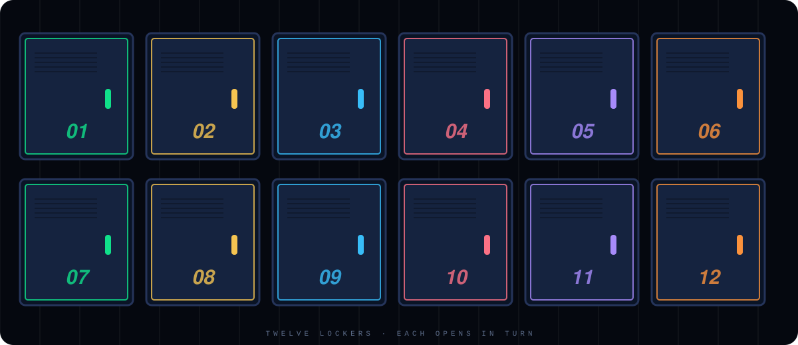
</div>

<br/>

| 🔐 LOCKER | 📝 WHAT'S INSIDE |
|---|---|
| `.github/workflows/` | GitHub Actions workflows |
| `public/` | Static assets served as-is |
| `scripts/` | `grant-admin.mjs` and `import-roster-csv.mjs` |
| `src/` | The application source |
| `supabase/` | Supabase backend files |
| `.env.example` | Template for the app's environment values |
| `.env.admin.example` | Template for the admin scripts' environment values |
| `roster-template.csv` | Starting template for roster data |
| `index.html` | The entry page Vite builds from |
| `package.json` | Scripts and dependencies |
| `tsconfig.json`, `vite.config.ts` | TypeScript and Vite configuration |
| `LICENSE` | The Unlicense |

<a name="license"></a>

Released under the [Unlicense](LICENSE). Take it, remix it, make it your own.

<div align="center">
</div>

<div align="center">


**ELITE-XI** · Built by [Syed Raqi](https://github.com/SyedRaqi) · [⭐ Star the repo](https://github.com/SyedRaqi/elite-xi)

<sub>A cinematic football intelligence platform. Every player. Every club. One football universe.</sub>

</div>
